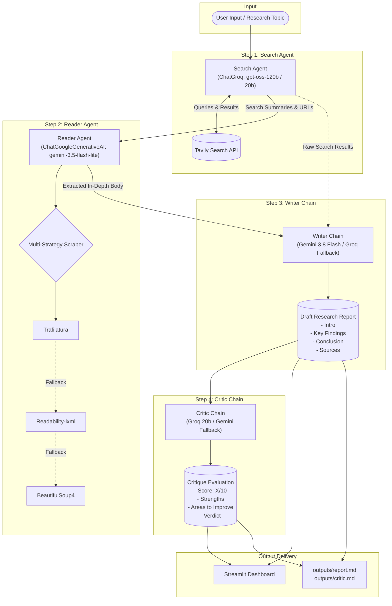

# 🛰️ DeepScan · Autonomous Multi-Agent Research System

[](https://www.python.org/)
[](https://www.langchain.com/)
[](https://streamlit.io/)
[](https://github.com/astral-sh/uv)
[](LICENSE)

> An end-to-end, multi-agent AI research pipeline that autonomously browses the live web, extracts and cleans deep article content, drafts comprehensive technical reports, and performs automated critical evaluations.

---

## 📑 Table of Contents

- [Overview](#overview)
- [Key Features](#key-features)
- [System Architecture](#system-architecture)
  - [Architecture Workflow](#architecture-workflow)
  - [Agent & Chain Breakdown](#agent--chain-breakdown)
  - [Resilience & Fallback Strategy](#resilience--fallback-strategy)
- [Technologies Used](#technologies-used)
- [Project Structure](#project-structure)
- [Installation & Setup](#installation--setup)
  - [Prerequisites](#prerequisites)
  - [Option A: Using `uv` (Recommended)](#option-a-using-uv-recommended)
  - [Option B: Using standard `venv` and `pip`](#option-b-using-standard-venv-and-pip)
- [Environment Configuration](#environment-configuration)
- [Usage](#usage)
  - [1. Streamlit Web Dashboard](#1-streamlit-web-dashboard)
  - [2. Command-Line Interface (CLI)](#2-command-line-interface-cli)
  - [3. Programmatic Usage](#3-programmatic-usage)
- [Outputs & Reports](#outputs--reports)
- [Contributing](#contributing)
- [License](#license)

---

## Overview

Traditional LLM generation often struggles with outdated training datasets, hallucinated citations, and superficial depth on niche or emerging topics. **DeepScan** overcomes these limitations by orchestrating a specialized team of autonomous AI agents and chains that execute a disciplined, staged research methodology:

1. **Discovery**: Queries real-time search indexes to discover authoritative sources and recent developments.
2. **Deep Reading**: Extracts, parses, and cleans the full text of the highest-value URL using a multi-engine fallback scraping cascade.
3. **Synthesis**: Compiles fragmented information into an executive-ready, structured research report with direct citations.
4. **Peer Review**: An independent critic model evaluates the report, highlights strengths, points out gaps, and delivers an objective score out of 10.

The system provides both a **cyberpunk / aurora-themed web dashboard** built with Streamlit and a **headless CLI pipeline** for automation and batch workflows.

---

## Key Features

- 🤖 **Collaborative Agent Hierarchy**: Divides research into distinct cognitive roles across Search, Reader, Writer, and Critic modules.
- 🌐 **Real-Time Web Intelligence**: Powered by the **Tavily AI Search API** for accurate, citation-backed web discovery.
- 🕷️ **Tri-Strategy Scraping Cascade**: Robust webpage reader combining **Trafilatura** (primary), **Readability-lxml** (secondary), and **BeautifulSoup4** (fallback) to eliminate ads, navigation boilerplate, and tracking scripts.
- 🔀 **Multi-Provider Fallback Routing**: Uses LangChain's `ModelFallbackMiddleware` and `.with_fallbacks()` across **Groq** and **Google Gemini** endpoints for continuous uptime.
- ⏱️ **Built-in Rate Limiting**: `InMemoryRateLimiter` prevents quota burnout and HTTP 429 errors under heavy query loads.
- 🖥️ **Cyberpunk / Aurora Web UI**: Custom-styled Streamlit interface featuring animated telemetry, live step progression cards, quick-launch chips, word counters, and instant Markdown download buttons.
- 📁 **Automated Markdown Exports**: Automatically persists final reports and critic evaluations to `outputs/report.md` and `outputs/critic.md`.

---

## System Architecture

### Architecture Workflow



### Agent & Chain Breakdown

| Role             | Module                 | Primary Model                                      | Fallback Model                                     | Tool / Action         | Purpose                                                                   |
| :--------------- | :--------------------- | :------------------------------------------------- | :------------------------------------------------- | :-------------------- | :------------------------------------------------------------------------ |
| **Search Agent** | `src/agents/agents.py` | `ChatGroq` (`openai/gpt-oss-120b`)                 | `ChatGroq` (`openai/gpt-oss-20b`)                  | `web_search` (Tavily) | Formulates search queries and extracts relevant links and snippets.       |
| **Reader Agent** | `src/agents/agents.py` | `ChatGoogleGenerativeAI` (`gemini-3.5-flash-lite`) | `ChatGroq` (`openai/gpt-oss-120b`)                 | `scrape_url`          | Analyzes top URLs, fetches content, and parses high-density text.         |
| **Writer Chain** | `src/agents/agents.py` | `ChatGoogleGenerativeAI` (`gemini-3.8-flash`)      | `ChatGroq` (`openai/gpt-oss-120b`)                 | LCEL Chain            | Synthesizes research into a structured markdown report.                   |
| **Critic Chain** | `src/agents/agents.py` | `ChatGroq` (`openai/gpt-oss-20b`)                  | `ChatGoogleGenerativeAI` (`gemini-3.5-flash-lite`) | LCEL Chain            | Evaluates clarity, rigor, and factual grounding, providing an X/10 score. |

### Resilience & Fallback Strategy

1. **Rate Limiting**: Configured with `InMemoryRateLimiter(requests_per_second=0.4)` to throttle outbound LLM calls.
2. **Middleware Fallbacks**: Agents utilize `ModelFallbackMiddleware` to gracefully switch providers if an endpoint fails or encounters rate limits.
3. **LCEL Fallbacks**: Chains use `.with_fallbacks()` to seamlessly redirect requests across alternative providers (Google Gemini ↔ Groq).
4. **Scraping Redundancy**: If `trafilatura` cannot extract article text (e.g. non-standard DOM), the scraper falls back to `readability-lxml`, and finally to stripped `BeautifulSoup4` text.

---

## Technologies Used

### Core Frameworks & AI

- **[LangChain](https://github.com/langchain-ai/langchain)** (`langchain`, `langchain-core`, `langchain-community`): Agent runtime, prompt templates, and pipeline composition.
- **[LangChain Groq](https://github.com/langchain-ai/langchain-groq)**: Ultra-fast inference integration with Groq Cloud.
- **[LangChain Google GenAI](https://github.com/langchain-ai/langchain-google)**: Access to Google's Gemini Flash series.
- **[LangChain Tavily](https://github.com/langchain-ai/langchain)** & **[Tavily Python](https://tavily.com/)**: Search engine tailored specifically for LLM and agentic workflows.
- **[LangChain NVIDIA](https://github.com/langchain-ai/langchain-nvidia-ai-endpoints)**: Support for NVIDIA AI Foundation endpoints.

### Web Scraping & Content Processing

- **[Trafilatura](https://github.com/adbar/trafilatura)**: Web content extraction engine optimized for text and news articles.
- **[Readability-lxml](https://github.com/buriy/python-readability)**: Python port of Arc90's readability algorithm for DOM cleanup.
- **[BeautifulSoup4](https://www.crummy.com/software/BeautifulSoup/)** & **[lxml](https://lxml.de/)**: HTML parsing, sanitization, and fallback DOM traversal.
- **[Requests](https://requests.readthedocs.io/)**: HTTP client configured with browser headers and timeout handling.

### User Interface & Utilities

- **[Streamlit](https://streamlit.io/)**: Reactive web interface with custom CSS styling and live status rendering.
- **[Rich](https://github.com/Textualize/rich)**: Terminal formatting and structured logging.
- **[Python-dotenv](https://github.com/theskumar/python-dotenv)**: Management of runtime secrets and environment keys.
- **[uv](https://github.com/astral-sh/uv)**: Next-generation Python package and project manager.

---

## Project Structure

```text
research_agent/
├── .env.example              # Template for required environment variables
├── .gitignore                # Git ignore rules for venv, cache, and secrets
├── LICENSE                   # MIT License
├── app.py                    # Streamlit web application dashboard
├── main.py                   # Headless CLI entry point
├── pyproject.toml            # Project metadata and uv dependencies
├── README.md                 # Project documentation
├── requirements.txt          # Standard pip requirements file
├── test.py                   # Model connectivity and latency testing utility
├── outputs/                  # Generated research reports & critic feedback
│   ├── report.md             # Latest synthesized research report
│   └── critic.md             # Latest peer-review critique & score
└── src/
    ├── __init__.py
    ├── agents/
    │   ├── __init__.py
    │   └── agents.py         # Agent definitions, models, chains, and prompts
    ├── pipeline/
    │   ├── __init__.py
    │   └── pipeline.py       # Sequential orchestrator pipeline logic
    └── tools/
        ├── __init__.py
        └── tools.py          # Tavily search tool & multi-engine scraper
```

---

## Installation & Setup

### Prerequisites

- **Python**: `>= 3.10` (Tested up to `3.14`)
- **API Keys**:
  - [Groq API Key](https://console.groq.com/) (Free tier available)
  - [Google Gemini API Key](https://aistudio.google.com/) (Free tier available)
  - [Tavily Search API Key](https://tavily.com/) (Free tier available)

---

### Option A: Using `uv` (Recommended)

[`uv`](https://github.com/astral-sh/uv) provides extremely fast dependency resolution and virtual environment management.

1. **Clone the repository**:

   ```bash
   git clone https://github.com/your-username/research-agent.git
   cd research-agent
   ```

2. **Create a virtual environment and install dependencies**:
   ```bash
   uv venv
   # On Windows (PowerShell):
   .venv\Scripts\activate
   # On Linux / macOS:
   source .venv/bin/activate

   uv pip install -r requirements.txt
   ```

---

### Option B: Using standard `venv` and `pip`

1. **Clone the repository**:

   ```bash
   git clone https://github.com/your-username/research-agent.git
   cd research-agent
   ```

2. **Create and activate a virtual environment**:

   ```bash
   # Windows (PowerShell)
   python -m venv .venv
   .venv\Scripts\Activate.ps1

   # Linux / macOS
   python3 -m venv .venv
   source .venv/bin/activate
   ```

3. **Install dependencies**:
   ```bash
   pip install --upgrade pip
   pip install -r requirements.txt
   ```

---

## Environment Configuration

1. Copy the example environment file:

   ```bash
   # Windows (PowerShell)
   Copy-Item .env.example .env

   # Linux / macOS
   cp .env.example .env
   ```

2. Open `.env` and fill in your API keys:
   ```env
   # Core API Keys (Required)
   GROQ_API_KEY="gsk_..."
   GOOGLE_API_KEY="AIza..."
   TAVILY_API_KEY="tvly-..."

   # Optional Providers (Fallback / Extensions)
   NVIDIA_API_KEY="nvapi-..."
   MISTRAL_API_KEY=""
   HUGGINGFACEHUB_ACCESS_TOKEN=""
   ```

---

## Usage

### 1. Streamlit Web Dashboard

To launch the interactive futuristic web interface:

```bash
streamlit run app.py
```

Once started, open your browser at `http://localhost:8501`. You can:

- Enter any custom research topic or click one of the quick-launch suggestions.
- Watch real-time execution across each agent stage (Search, Reader, Writer, Critic).
- Inspect telemetry (total URLs analyzed, report word count, total latency).
- Read the final formatted report and review the critic's score badge.
- Download the generated research report directly as a Markdown (`.md`) file.

### 2. Command-Line Interface (CLI)

For headless or script-based research runs:

```bash
python main.py
```

You will be prompted to enter a research topic:

```text
Enter a research topic: Latest developments in artificial intelligence in healthcare
```

The pipeline will print live agent execution logs in the terminal and automatically save the output files to the `outputs/` directory.

### 3. Programmatic Usage

You can also integrate the pipeline directly into your own Python applications:

```python
from src.pipeline.pipeline import run_research_pipeline

topic = "Next-generation multi-agent coordination architectures"
state = run_research_pipeline(topic)

print("Report:")
print(state["report"])

print("\nCritic Review:")
print(state["feedback"])
```

---

## Outputs & Reports

Every research execution produces two deliverables inside the `outputs/` directory:

- **`outputs/report.md`**: The complete synthesized research paper, including:
  - **Executive Introduction**
  - **Key Findings** with in-depth analysis
  - **Strategic Conclusion**
  - **Numbered Sources and URLs**
- **`outputs/critic.md`**: An objective peer review containing:
  - Strict rating (`Score: X/10`)
  - Itemized **Strengths**
  - Itemized **Areas to Improve**
  - **One-line Verdict**

---

## Contributing

Contributions are very welcome! To contribute:

1. **Fork** the repository.
2. **Create a feature branch**:
   ```bash
   git checkout -b feature/amazing-feature
   ```
3. **Commit your changes**:
   ```bash
   git commit -m "Add amazing feature"
   ```
4. **Push to the branch**:
   ```bash
   git push origin feature/amazing-feature
   ```
5. **Open a Pull Request**.

---

## License

This project is licensed under the [MIT License](LICENSE). Feel free to use, modify, and distribute it in your own projects.
